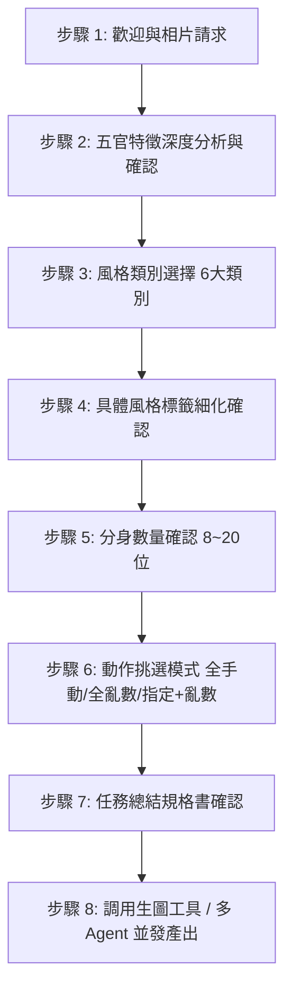

# 人物數位孿生與多姿勢 IP 分身畫布架構師 (Digital Twin Avatar & Multi-Pose Sheet Architect)

[](https://github.com/JeffreyHo0520/digital-twin-avatar-sheet-architect)
[](https://opensource.org/licenses/MIT)
[]()

> 專為教師、講師、創作者與專業人士打造的 **「人物數位孿生 (Digital Twin)」** 與 **「個人 IP 多姿勢角色分身畫布」** 全域 AI 技能。
> 支援從一張真實照片深度鎖定視覺特徵，一鍵產出單張白色畫布上的多姿勢插畫合集（Wide-angle, strictly NO TEXT），並支援最多 6 個 Sub-Agents 並發繪製獨立高解析透明/純白底圖。

---

## 🌟 核心特色

1. **五官特徵高保真錨定 (Visual DNA Anchoring)**
   - 極細緻解析：臉型比例、眼神神韻、鼻樑高度、唇型、眉毛濃淡、眼鏡精確款式、髮型分布與漸層推剪比例（High Fade / 灰白比例）及專屬身材體態穿搭。
2. **單一純白畫布原則 (Single Clean White Canvas)**
   - 8～20 位分身整齊排列於單一張 100% 純淨白底畫布，極度方便裁切、去背與排版。
3. **強制性零文字限制 (Strict NO TEXT Policy)**
   - 嚴禁畫面出現任何字母、標籤、箭頭、數字或浮水印，保持最高素材可用度。
4. **40 組教學/專業動作編排庫**
   - 內建涵蓋講課、數位應用、引導解說、情感張力、運動示範等 40 組標準化動作與中英文 Prompt 語彙庫。
5. **多 Sub-Agent 並發加速架構 (Multi-Agent Pipeline)**
   - 支援同時啟動最多 6 個 Sub-Agents 並行生成各姿勢的獨立高解析圖檔。
6. **雙軌生圖容錯機制 (Dual-Engine Failover)**
   - 優先調用 Native ImageGen；遭遇 Quota 429 資源限制時，自動無縫切換至 Canva MCP 生圖引擎。

---

## 🚀 跨電腦快速安裝指南 (Quick Installation)

要在任何另一台電腦或工作環境中安裝並載入此技能，請依據作業系統執行以下指令：

### 方式 A：Windows (PowerShell 一鍵安裝)

打開 PowerShell 終端機，執行：

```powershell
git clone https://github.com/JeffreyHo0520/digital-twin-avatar-sheet-architect.git "$env:USERPROFILE\.gemini\config\skills\digital-twin-avatar-sheet-architect"
```

或使用本儲存庫內附的一鍵安裝腳本：

```powershell
irm https://raw.githubusercontent.com/JeffreyHo0520/digital-twin-avatar-sheet-architect/main/install.ps1 | iex
```

---

### 方式 B：macOS / Linux (Bash)

打開 Terminal，執行：

```bash
git clone https://github.com/JeffreyHo0520/digital-twin-avatar-sheet-architect.git ~/.gemini/config/skills/digital-twin-avatar-sheet-architect
```

---

### 方式 C：專案內部限定安裝 (Project Workspace)

若只需在特定專案中使用，可將儲存庫 Clone 至專案根目錄的 `.agents/skills/` 資料夾：

```bash
git clone https://github.com/JeffreyHo0520/digital-twin-avatar-sheet-architect.git .agents/skills/digital-twin-avatar-sheet-architect
```

---

## 🎯 觸發關鍵字 (Triggers)

在對話中提及以下任何關鍵字，即可自動喚醒本技能：

- `人物數位孿生`
- `數位孿生分身`
- `多姿勢分身圖`
- `個人 IP 分身畫布`
- `老師教學動作分身`
- `照片轉多動作插畫`
- `角色多姿勢合集`
- `/digital-twin-avatar-sheet-architect`

---

## 📋 8 步標準循序工作流

本技能嚴格執行「一次一步驟、確認後推進」原則：



1. **步驟 1：歡迎與相片請求**：引導上傳清晰人物照或設定圖。
2. **步驟 2：五官特徵分析與確認**：深度拆解臉型、眼神、鼻樑、唇型、眉毛、眼鏡、髮型與體態穿搭，條列等待確認。
3. **步驟 3：風格類別選擇**：
   - 1. 專業與商務邏輯
   - 2. 現代科技與未來派
   - 3. UI 介面與材質質感
   - 4. 敘事與資訊視覺化
   - 5. 藝術美學與潮流
   - 6. 溫馨生活與插畫風格（或自訂）
4. **步驟 4：具體風格確認**：提供細化風格子標籤（例如 4-A 視覺敘事、4-B 現代資訊圖表）。
5. **步驟 5：分身數量確認**：指定單一畫布上呈現 8～20 位分身。
6. **步驟 6：動作挑選模式**：
   - (A) 全手動：自選 N 個編號。
   - (B) 全亂數：由 AI 遴選張力均衡的教學組合。
   - (C) 指定 + 亂數：指定重點編號，其餘由 AI 補足。
7. **步驟 7：任務總結確認**：條列規格書並發起最終確認。
8. **步驟 8：最終生圖執行**：產出單張白色畫布全姿勢總覽；亦可啟動最多 6 個 Sub-Agents 並行生成各姿勢獨立透明素材。

---

## 📚 老師教學動作編排庫 (40 組標準庫)

| 編號 | 動作名稱 | 英文 Prompt 關鍵語彙 | 編號 | 動作名稱 | 英文 Prompt 關鍵語彙 |
| :---: | :--- | :--- | :---: | :--- | :--- |
| **1** | 舉手回答 | Raising hand to answer or ask question | **21** | 持指揮棒指白板 | Holding pointer pointing at whiteboard |
| **2** | 做詳細筆記 | Taking meticulous notes on notepad | **22** | 黑板寫公式 | Writing mathematical formula on board |
| **3** | 手托腮聽講 | Hand resting under chin listening intently | **23** | 彎腰看學生作業 | Leaning over reviewing student work |
| **4** | 台上簡報 | Presenting on stage with open-palm gestures | **24** | 持擴音器說話 | Speaking through a megaphone |
| **5** | 閱讀教科書 | Reading an open textbook focused | **25** | 講台分發考卷 | Distributing exam papers from podium |
| **6** | 頭頂鉛筆思考 | Thinking with pencil balanced on head | **26** | 平板演示 App | Holding and demonstrating tablet app |
| **7** | 使用計算機 | Calculating numbers on desktop calculator | **27** | 操作投影機 | Adjusting and operating ceiling projector |
| **8** | 焦慮看時鐘 | Looking at wristwatch with urgency | **28** | 進行科學實驗 | Holding beaker doing science experiment |
| **9** | 坐在桌前改考卷 | Grading test papers with red pen at desk | **29** | 翻閱點名冊 | Flipping through student attendance binder |
| **10** | 擦拭黑板 | Wiping chalkboard clean with an eraser | **30** | 粉筆與板擦並用 | Holding chalk in one hand, eraser in other |
| **11** | 削彩色鉛筆 | Sharpening colored pencils with sharpener | **31** | 對鏡頭揮手 | Warmly waving hello with one hand |
| **12** | 整理文件夾 | Organizing colorful document binders | **32** | 校園長廊行走 | Confidently walking through hallway |
| **13** | 拿杯子喝水 | Holding mug sipping warm water/coffee | **33** | 小組討論 | Leading animated small group discussion |
| **14** | 操作筆電 | Expertly typing and working on slim laptop | **34** | 持地球儀教學 | Spinning educational globe with hands |
| **15** | 摸下巴沉思 | Thoughtfully stroking chin in deep reflection | **35** | 調整顯微鏡 | Looking into and adjusting microscope |
| **16** | 搬運重書 | Carrying a heavy stack of hardback books | **36** | 碼錶計時 | Holding stopwatch timing an exam/activity |
| **17** | 歡呼慶祝 | Cheering triumphantly with fists pumped | **37** | 公告欄貼海報 | Pinning announcement poster to board |
| **18** | 指圖表說明 | Outstretched arm pointing at diagram | **38** | 指導球類運動 | Athletic coach pose demonstrating ball drill |
| **19** | 趴桌補眠 | Head resting on crossed arms taking a nap | **39** | 頒發獎狀 | Presenting an award certificate honor |
| **20** | 手機通話 | Talking on modern smartphone professionally | **40** | 黑板繪製地圖 | Drawing geographical map on large board |

---

## 📄 授權條款

本專案採用 [MIT License](LICENSE) 開源授權，歡迎自由修改與分享。
